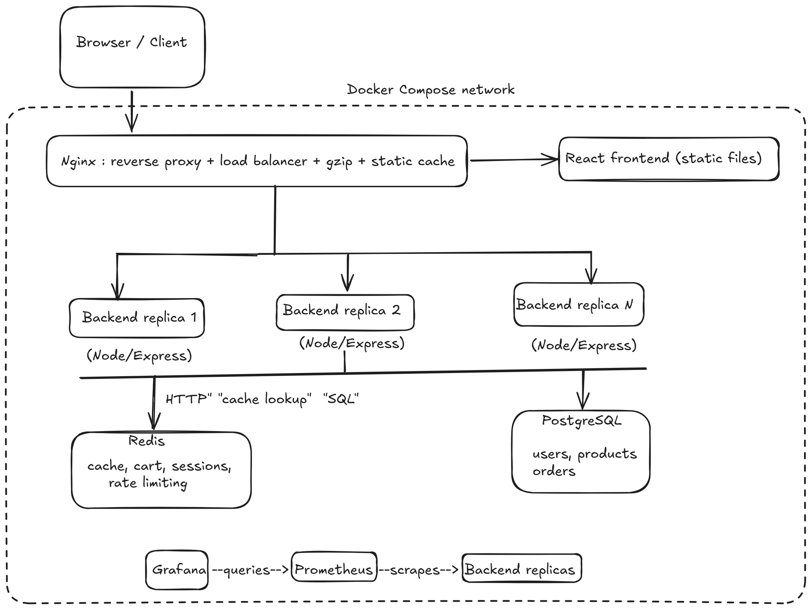
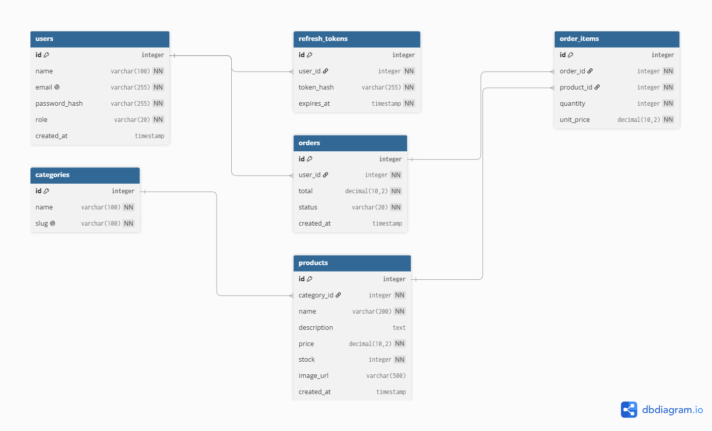



# Scalable E-Commerce Platform

A scalable e-commerce platform with Redis caching, Nginx load balancing across replicas, and a
Dockerized deployment. Load tested with k6: 3,000 concurrent shoppers at 0% errors, ~3,900 req/s
peak on a single laptop, and Redis lifting throughput from ~230 to 1,000+ req/s.

> Work in progress: building day by day over 30 days.

## Architecture

## Database design

## Tech stack

React, Node.js/Express, PostgreSQL, Redis, Docker Compose, Nginx,
k6, Prometheus/Grafana, GitHub Actions
